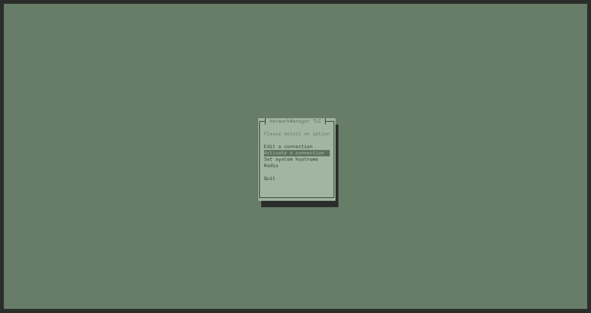
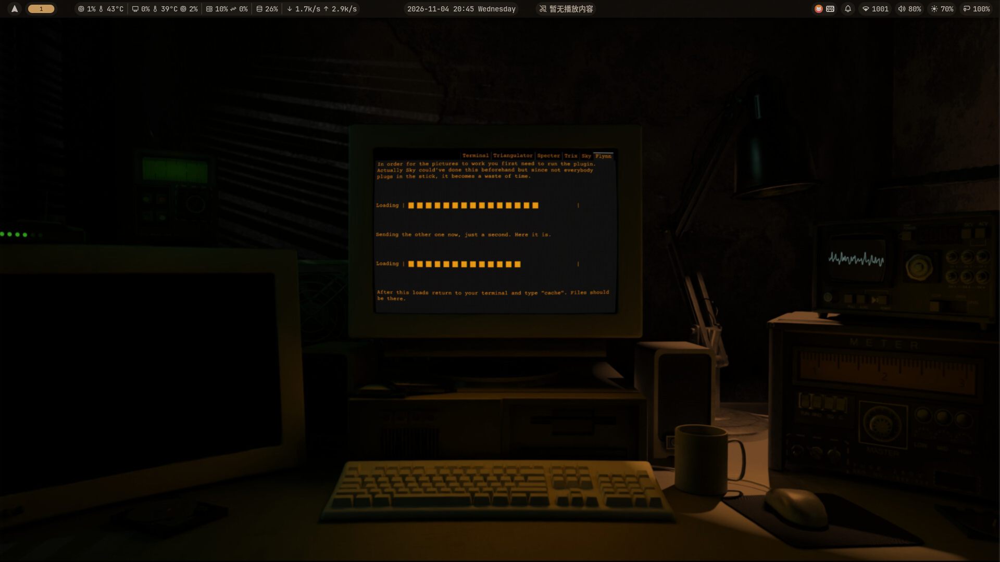
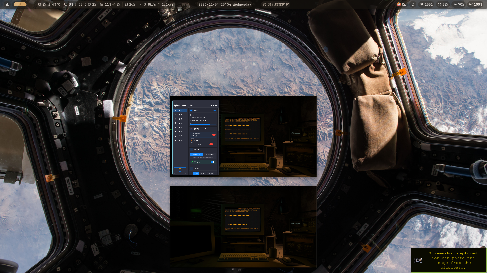
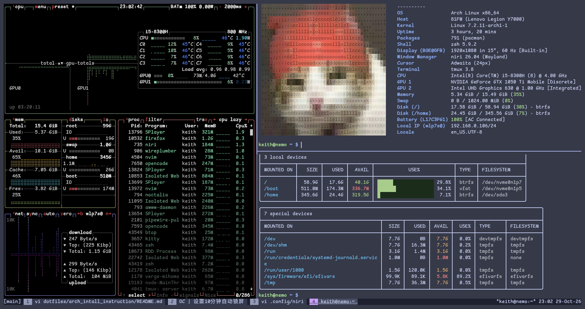
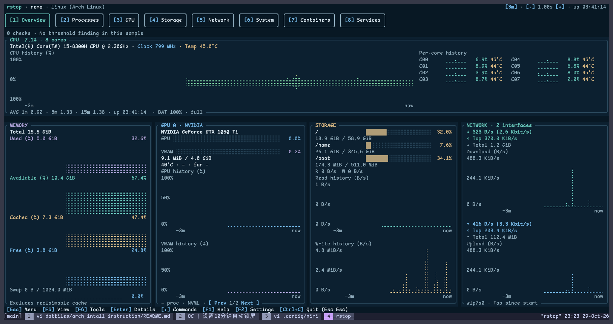

<!-- START doctoc generated TOC please keep comment here to allow auto update -->
<!-- DON'T EDIT THIS SECTION, INSTEAD RE-RUN doctoc TO UPDATE -->
**Table of Contents**  *generated with [DocToc](https://github.com/thlorenz/doctoc)*

- [P0. 前言](#p0-%E5%89%8D%E8%A8%80)
- [P1. Arch Linux 安装](#p1-arch-linux-%E5%AE%89%E8%A3%85)
  - [一、 前提准备](#%E4%B8%80-%E5%89%8D%E6%8F%90%E5%87%86%E5%A4%87)
    - [1.1 U盘](#11-u%E7%9B%98)
    - [1.2 ISO镜像](#12-iso%E9%95%9C%E5%83%8F)
    - [1.3 PC配置要求](#13-pc%E9%85%8D%E7%BD%AE%E8%A6%81%E6%B1%82)
  - [二、 Manual Steps](#%E4%BA%8C-manual-steps)
    - [2.1 时钟同步和镜像验证](#21-%E6%97%B6%E9%92%9F%E5%90%8C%E6%AD%A5%E5%92%8C%E9%95%9C%E5%83%8F%E9%AA%8C%E8%AF%81)
    - [2.2 联网](#22-%E8%81%94%E7%BD%91)
      - [2.2.1 wifi](#221-wifi)
      - [2.2.2 ethernet](#222-ethernet)
    - [2.3 磁盘划分](#23-%E7%A3%81%E7%9B%98%E5%88%92%E5%88%86)
      - [2.3.1 规划](#231-%E8%A7%84%E5%88%92)
      - [2.3.2 操作](#232-%E6%93%8D%E4%BD%9C)
        - [2.3.2.1 分区制作](#2321-%E5%88%86%E5%8C%BA%E5%88%B6%E4%BD%9C)
        - [2.3.2.2 分区格式化](#2322-%E5%88%86%E5%8C%BA%E6%A0%BC%E5%BC%8F%E5%8C%96)
        - [2.3.2.3 分区挂载](#2323-%E5%88%86%E5%8C%BA%E6%8C%82%E8%BD%BD)
      - [2.3.3 分区划分验证](#233-%E5%88%86%E5%8C%BA%E5%88%92%E5%88%86%E9%AA%8C%E8%AF%81)
    - [2.4. linux base](#24-linux-base)
      - [2.4.1 换pacman镜像源](#241-%E6%8D%A2pacman%E9%95%9C%E5%83%8F%E6%BA%90)
      - [2.4.2 linux镜像及固件安装](#242-linux%E9%95%9C%E5%83%8F%E5%8F%8A%E5%9B%BA%E4%BB%B6%E5%AE%89%E8%A3%85)
    - [2.5 基本配置](#25-%E5%9F%BA%E6%9C%AC%E9%85%8D%E7%BD%AE)
      - [2.5.1 base配置及安装](#251-base%E9%85%8D%E7%BD%AE%E5%8F%8A%E5%AE%89%E8%A3%85)
      - [2.5.2 grub安装](#252-grub%E5%AE%89%E8%A3%85)
      - [2.5.3 网络工具](#253-%E7%BD%91%E7%BB%9C%E5%B7%A5%E5%85%B7)
    - [2.6 用户空间操作](#26-%E7%94%A8%E6%88%B7%E7%A9%BA%E9%97%B4%E6%93%8D%E4%BD%9C)
      - [2.6.1 wifi连接](#261-wifi%E8%BF%9E%E6%8E%A5)
      - [2.6.2 新增用户](#262-%E6%96%B0%E5%A2%9E%E7%94%A8%E6%88%B7)
      - [2.6.3 门户、桌面等常用配置](#263-%E9%97%A8%E6%88%B7%E6%A1%8C%E9%9D%A2%E7%AD%89%E5%B8%B8%E7%94%A8%E9%85%8D%E7%BD%AE)
        - [2.6.3.1 补充及启动](#2631-%E8%A1%A5%E5%85%85%E5%8F%8A%E5%90%AF%E5%8A%A8)
        - [2.6.3.2 终端](#2632-%E7%BB%88%E7%AB%AF)
        - [2.6.3.3 窗口管理器](#2633-%E7%AA%97%E5%8F%A3%E7%AE%A1%E7%90%86%E5%99%A8)
        - [2.6.3.4 门户管理器](#2634-%E9%97%A8%E6%88%B7%E7%AE%A1%E7%90%86%E5%99%A8)
        - [2.6.3.5 浏览器](#2635-%E6%B5%8F%E8%A7%88%E5%99%A8)
        - [2.6.3.6 字体管理](#2636-%E5%AD%97%E4%BD%93%E7%AE%A1%E7%90%86)
        - [2.6.3.7 文件管理](#2637-%E6%96%87%E4%BB%B6%E7%AE%A1%E7%90%86)
        - [2.6.3.8 音视频/粘贴板/画板等](#2638-%E9%9F%B3%E8%A7%86%E9%A2%91%E7%B2%98%E8%B4%B4%E6%9D%BF%E7%94%BB%E6%9D%BF%E7%AD%89)
        - [2.6.3.9 版本管理](#2639-%E7%89%88%E6%9C%AC%E7%AE%A1%E7%90%86)
        - [2.6.3.10 包管理器和构建工具](#26310-%E5%8C%85%E7%AE%A1%E7%90%86%E5%99%A8%E5%92%8C%E6%9E%84%E5%BB%BA%E5%B7%A5%E5%85%B7)
        - [2.6.3.11 noctalia桌面](#26311-noctalia%E6%A1%8C%E9%9D%A2)
        - [2.6.3.12 agents](#26312-agents)
        - [2.6.3.13 misc](#26313-misc)
    - [2.7 双系统注意事项](#27-%E5%8F%8C%E7%B3%BB%E7%BB%9F%E6%B3%A8%E6%84%8F%E4%BA%8B%E9%A1%B9)
      - [2.7.1 关闭 Windows 快速启动和休眠](#271-%E5%85%B3%E9%97%AD-windows-%E5%BF%AB%E9%80%9F%E5%90%AF%E5%8A%A8%E5%92%8C%E4%BC%91%E7%9C%A0)
      - [2.7.2 从 Windows 切到 Linux 的习惯](#272-%E4%BB%8E-windows-%E5%88%87%E5%88%B0-linux-%E7%9A%84%E4%B9%A0%E6%83%AF)
      - [2.7.3 ESP 与引导](#273-esp-%E4%B8%8E%E5%BC%95%E5%AF%BC)
      - [2.7.4 时间](#274-%E6%97%B6%E9%97%B4)
      - [2.7.5 Windows 更新后复查](#275-windows-%E6%9B%B4%E6%96%B0%E5%90%8E%E5%A4%8D%E6%9F%A5)
      - [2.7.6 快速排查](#276-%E5%BF%AB%E9%80%9F%E6%8E%92%E6%9F%A5)
  - [三、Agentic Install](#%E4%B8%89agentic-install)
    - [3.1 角色边界](#31-%E8%A7%92%E8%89%B2%E8%BE%B9%E7%95%8C)
    - [3.2 前置：Live 环境（人工）](#32-%E5%89%8D%E7%BD%AElive-%E7%8E%AF%E5%A2%83%E4%BA%BA%E5%B7%A5)
      - [3.2.1 联网](#321-%E8%81%94%E7%BD%91)
      - [3.2.2 时间同步](#322-%E6%97%B6%E9%97%B4%E5%90%8C%E6%AD%A5)
      - [3.2.3 安装并启动 SSH](#323-%E5%AE%89%E8%A3%85%E5%B9%B6%E5%90%AF%E5%8A%A8-ssh)
      - [3.2.4 认证方式](#324-%E8%AE%A4%E8%AF%81%E6%96%B9%E5%BC%8F)
      - [3.2.5 获取 IP、核对 host key](#325-%E8%8E%B7%E5%8F%96-ip%E6%A0%B8%E5%AF%B9-host-key)
      - [3.2.6 开一个 tmux](#326-%E5%BC%80%E4%B8%80%E4%B8%AA-tmux)
    - [3.3 Agent 连接方式](#33-agent-%E8%BF%9E%E6%8E%A5%E6%96%B9%E5%BC%8F)
    - [3.4 分阶段执行](#34-%E5%88%86%E9%98%B6%E6%AE%B5%E6%89%A7%E8%A1%8C)
      - [Phase 0：只读发现](#phase-0%E5%8F%AA%E8%AF%BB%E5%8F%91%E7%8E%B0)
      - [Phase 1：生成安装计划](#phase-1%E7%94%9F%E6%88%90%E5%AE%89%E8%A3%85%E8%AE%A1%E5%88%92)
      - [Phase 2：分区与格式化](#phase-2%E5%88%86%E5%8C%BA%E4%B8%8E%E6%A0%BC%E5%BC%8F%E5%8C%96)
      - [Phase 3：安装 base](#phase-3%E5%AE%89%E8%A3%85-base)
      - [Phase 4：chroot 配置](#phase-4chroot-%E9%85%8D%E7%BD%AE)
      - [Phase 5：重启前验收](#phase-5%E9%87%8D%E5%90%AF%E5%89%8D%E9%AA%8C%E6%94%B6)
      - [Phase 6：安装后验收](#phase-6%E5%AE%89%E8%A3%85%E5%90%8E%E9%AA%8C%E6%94%B6)
    - [3.5 Agent 操作守则](#35-agent-%E6%93%8D%E4%BD%9C%E5%AE%88%E5%88%99)
    - [3.6 建议的脚本布局](#36-%E5%BB%BA%E8%AE%AE%E7%9A%84%E8%84%9A%E6%9C%AC%E5%B8%83%E5%B1%80)
    - [3.7 可选：声明式安装](#37-%E5%8F%AF%E9%80%89%E5%A3%B0%E6%98%8E%E5%BC%8F%E5%AE%89%E8%A3%85)
    - [3.8 常见坑](#38-%E5%B8%B8%E8%A7%81%E5%9D%91)
    - [3.9 最小验收清单](#39-%E6%9C%80%E5%B0%8F%E9%AA%8C%E6%94%B6%E6%B8%85%E5%8D%95)
- [四、Linux Selection](#%E5%9B%9Blinux-selection)
  - [4.1 先看结论](#41-%E5%85%88%E7%9C%8B%E7%BB%93%E8%AE%BA)
  - [4.2 新手友好型](#42-%E6%96%B0%E6%89%8B%E5%8F%8B%E5%A5%BD%E5%9E%8B)
    - [4.2.1 Linux Mint](#421-linux-mint)
    - [4.2.2 Ubuntu LTS](#422-ubuntu-lts)
    - [4.2.3 Fedora Workstation](#423-fedora-workstation)
    - [4.2.4 Pop!_OS](#424-pop_os)
    - [4.2.5 Debian Stable](#425-debian-stable)
    - [4.2.6 openSUSE Tumbleweed 与 Leap](#426-opensuse-tumbleweed-%E4%B8%8E-leap)
    - [4.2.7 外观优先：Zorin OS 与 elementary OS](#427-%E5%A4%96%E8%A7%82%E4%BC%98%E5%85%88zorin-os-%E4%B8%8E-elementary-os)
  - [4.3 不可变与原子更新](#43-%E4%B8%8D%E5%8F%AF%E5%8F%98%E4%B8%8E%E5%8E%9F%E5%AD%90%E6%9B%B4%E6%96%B0)
  - [4.4 Arch 系：想用 Arch 但不想手装](#44-arch-%E7%B3%BB%E6%83%B3%E7%94%A8-arch-%E4%BD%86%E4%B8%8D%E6%83%B3%E6%89%8B%E8%A3%85)
    - [4.4.1 EndeavourOS](#441-endeavouros)
    - [4.4.2 Manjaro](#442-manjaro)
    - [4.4.3 CachyOS](#443-cachyos)
    - [4.4.4 Arch 与 archinstall](#444-arch-%E4%B8%8E-archinstall)
  - [4.5 进阶型](#45-%E8%BF%9B%E9%98%B6%E5%9E%8B)
    - [4.5.1 NixOS](#451-nixos)
    - [4.5.2 Gentoo](#452-gentoo)
    - [4.5.3 Void Linux](#453-void-linux)
    - [4.5.4 Alpine Linux（了解即可）](#454-alpine-linux%E4%BA%86%E8%A7%A3%E5%8D%B3%E5%8F%AF)
    - [4.5.5 Slackware 与 LFS（了解即可）](#455-slackware-%E4%B8%8E-lfs%E4%BA%86%E8%A7%A3%E5%8D%B3%E5%8F%AF)
  - [4.6 怎么选：按人群](#46-%E6%80%8E%E4%B9%88%E9%80%89%E6%8C%89%E4%BA%BA%E7%BE%A4)
  - [4.7 试错成本最低的方式](#47-%E8%AF%95%E9%94%99%E6%88%90%E6%9C%AC%E6%9C%80%E4%BD%8E%E7%9A%84%E6%96%B9%E5%BC%8F)
- [Resources](#resources)

<!-- END doctoc generated TOC please keep comment here to allow auto update -->

# P0. 前言

这份记录对本人来说既是一份备忘录，也是一份`unix-like`引导，希望对来往的朋友有所帮助。当然，若你选择`archinstall`你可以直接百万撤离了。
除此之外，这里也会有一份Agentic Install的教程。但是，如果从 Arch 的特点来看，若你需要的是一个完全可控、高自由度
的系统，Arch-based 的系统将是你的首选之一。

> note: 对于linux小白来说，不建议安装 Arch linux。这或许地狱模式开局，经历多次失败，建议安装 Debian-based (Debian-stable or Ubuntu)或者openSUSE。


# P1. Arch Linux 安装

## 一、 前提准备

### 1.1 U盘
你需要准备一个Ventoy U盘，可以装载多个系统镜像。需要注意的是：U盘容量要足够，一般10G以上

> 备选：如果没有Ventoy U盘，那么格式化后的U盘亦可；但是有三个明显缺点：1、U盘格式化之前可能需要额外的数据备份或迁移；2、U盘容量未能充分利用；3、需要额外的iso镜像烧录工具（e.g., rufus）将iso镜像导入到U盘中。


### 1.2 ISO镜像

安装较新版本的iso镜像，这里以版本[V2026.10.01](https://mirrors.tuna.tsinghua.edu.cn/archlinux/iso/2026.10.01/archlinux-2026.10.01-x86_64.iso)为例。


### 1.3 PC配置要求 

对于一个安装新手，我建议拿老旧笔记本（e.g., ThinkPad）练练手，但是基本的配置还是有要求的，下面的配置是我的最低配置建议：
1. 内存：4GB RAM
2. 外存：50GB 
3. CPU：`x86_64`兼容的任何CPU


## 二、 Manual Steps

### 2.1 时钟同步和镜像验证
```bash
<!-- 可选，验证下载的archlinux镜像完整性 -->
gpg --verify archlinux-2026.10.01-x86_64.iso.sig archlinux-2026.10.01-x86_64.iso
timedatectl set-ntp true
```

### 2.2 联网

先验证是否可以联网
```bash
ping baidu.com -c 3
```
如果显示有包传输和时延，说明联网成功。

#### 2.2.1 wifi
```bash
<!-- 允许网卡设备射频 -->
rfkill unblock wifi
<!-- 显示可用wlan网卡接口 -->
iwctl device list
<!-- 假设上面显示的wlan接口为<wlan>,显示可用wifi -->
iwctl station <wlan> get-networks
<!-- wifi连接，假如上面得到<SSID> <wifi-passwd>是你的wifi密码 -->
iwctl station <wlan> connect <SSID> password <wifi-passwd>
```
#### 2.2.2 ethernet
```bash
<!-- 显示ethernet接口 -->
ip link 
pacman -S dhcpcd
<!-- 连接以太网，假设以太网名称：<e-name> -->
dhcpcd <e-name>
```
> 注意：在联网操作之后，请再次验证是否成功

### 2.3 磁盘划分
#### 2.3.1 规划
在磁盘划分之前，我们需要按照配置给磁盘做合理的划分。但是，常见的磁盘划分基本只做3或4部分的划分，其中`efi`分区和`swap`虚存分区大小区间相对固定。

+ 3划分
  + `efi`分区
  + `swap`分区
  + 根分区 `/`

+ 4划分
  + `efi`分区
  + `swap`分区
  + 根分区 `/`
  + 主分区`/home`

`efi`分区通常设置为500M左右就绰绰有余；如果你的内存大小达16GB，那么`swap`可以设置小一点（300~500M）；反之，则一般设大点，比如你只有4G RAM，建议`swap`设置成1G。如果做3划分，其他外存空间自动获得；如果是4划分，那么依据规律"`/home`空间需求一般大于`/`"，将根目录`/`设定小一点，`/home`设置大一点。


**规划实例**
**1. 3划分(4GB RAM/51.5GB 外存)**
| 分区           | 大小  |  设定目标  |
| :------------- | :---: | :--------: |
| /dev/target1p4  | 500M  | `efi`分区  |
| /dev/target1p5 |  1G   | `swap`分区 |
| /dev/target1p6 |  50G  |  `/`分区   |

**2. 4划分(64GB RAM/551G 外存)**
| 分区           | 大小  |  设定目标   |
| :------------- | :---: | :---------: |
| /dev/target1p4  | 500M  |  `efi`分区  |
| /dev/target1p5 | 500M  | `swap`分区  |
| /dev/target1p6 |  50G  |   `/`分区   |
| /dev/target2p3 | 500G  | `/home`分区 |

>note:对于`/`分区和`/home`分区，可以按照参照这里的4划分，但`/`分区依据经验一般保险起见设置大于等于25G; 此外，这样的swap大小设计是基于无Hibernate的情况，否则一般设定swap > RAM。

#### 2.3.2 操作
##### 2.3.2.1 分区制作

```bash
<!-- 查看磁盘列表,选择目标分区 -->
fdisk -l
<!-- 清屏 或者 ctrl + l -->
clear
```
假设目标磁盘设备为/dev/target1 和 /dev/target2

```bash
<!-- 3划分示例 -->
fdisk /dev/target1
<!-- 假设 target1 设备上的目标分区为partition4/5/6 (p4/5/6)， -->
<!-- i.e.,/dev/target1p4 /dev/target1p5 /dev/target1p6 。下面是常见操作 -->
<!-- !下面是常见操作，按需自由操作 -->
<!-- 查看磁盘分区basic operation -->
m
<!-- 删除磁盘分区（危险操作小心，但是也别担心，直接按q退出就行，别按w写入） -->
d
<!-- 新建分区 -->
n
<!-- 打印磁盘分区，建议每次设定分区之后，都打印查看一次 -->
p
<!-- 格式化,危险操作，除非整个disk（这里是target1）都是目标分区 -->
g
<!-- 写入磁盘分区表 -->
w
```
跨设备划分继续
```bash
<!-- 4划分示例 -->
fdisk /dev/target2
<!-- 假设 target2 设备上的目标分区为partition3 (p3)，i.e., /dev/target2p3 -->
<!-- 操作同上target1 -->
```
>note:在写入分区大小时只要在提示行出现`sector`/L`+`字样时用`+<size>`设定，比如`+100M`/`+1G`。 

##### 2.3.2.2 分区格式化

3划分
```bash
mkfs.fat -F32 /dev/target1p4
mkswap /dev/target1p5
swapon /dev/target1p5

mkfs.btrfs -f /dev/target1p6
<!-- 或者 ext4格式 -->
<!-- mkfs.ext4 -f /dev/target1p6 -->
```

4划分则继续
```bash
mkfs.btrfs -f /dev/target2p3
<!-- 或者 ext4格式 -->
<!-- mkfs.ext4 -f /dev/target2p3 -->
```

##### 2.3.2.3 分区挂载

3划分
```bash
<!-- 文件架构提供/mnt挂在系统分区，故将`/`目录挂载到/mnt -->
mount /dev/target1p6 /mnt
<!-- 启动盘路径 -->
mkdir /mnt/boot
<!-- efi启动盘挂载 -->
mount /dev/target1p4 /mnt/boot
```

4划分继续
```bash
mkdir /mnt/home
mount /dev/target2p3 /mnt/home
```

#### 2.3.3 分区划分验证
```bash
<!-- 查看磁盘划分后的磁盘大小，文件类型，挂载点，分区类型 -->
lsblk -f
```

### 2.4. linux base
Arch linux的iso镜像提供linux内核，但仍然需要`pacstrap`安装它，这里提供最小安装。

#### 2.4.1 换pacman镜像源

```bash
vim /etc/pacman.conf
```
取消注释Color，具体操作： 按`/Color`找到Color位置，之后`bx`取消注释并按`:w`保存，
然后按`/mirrorlist`跳转到mirrorlist，按`gf`跳转文件，只保留China的镜像源（具体操作：
`/China`->`dgg`->`}`->`dG`），并且依据地理位置就近的原则，调整优先级，比如离南京大学近，就将nju的镜像源放到最上。

>note:老版本的镜像源可能需要reflector工具筛选镜像源

#### 2.4.2 linux镜像及固件安装

```bash
<!-- 修改镜像源后，更新pacman database-->
pacman -Sy
<!-- 更新 pacman 的 GPG 密钥环 -->
pacman -Syu archlinux-keyring
pacstrap /mnt base linux linux-firmware
<!-- 重要，根据当前挂载情况，用 UUID 生成 /etc/fstab，让新系统开机自动挂载各分区 -->
genfstab -U /mnt >> /mnt/etc/fstab
```
完成最小linux及其固件安装。

### 2.5 基本配置

#### 2.5.1 base配置及安装
```bash
vim /mnt/etc/locale.gen
```
取消注释`en_US.UTF-8`和`zh_CN.UTF-8`两行。

```bash
vim /mnt/etc/locale.conf
```
写入`LANG=en_US.UTF-8` 或`zh_CN.UTF-8`

```bash
<!-- {hostname} 是你想要的主机名 -->
echo "127.0.0.1 ${hostname}.localdomain ${hostname}" >> /mnt/etc/hosts
echo "${hostname}" >> /mnt/etc/hostname
```

```bash
<!-- 进入root用户 -->
arch-chroot  /mnt
<!-- 时区同步 -->
ln -sf /usr/share/zoneinfo/Asia/Shanghai /etc/localtime
hwclock --systohc
<!-- 为root用户生成相应的字符集 -->
locale-gen
<!-- 输入root用户密码并确认 -->
passwd
<!-- 查看机器架构 -->
uname -a
<!-- 下面下载intel cpu的微码intel-ucode，amd下载相应的微码amd-ucode -->
pacman -S intel-ucode efibootmgr grub 
```
多系统继续
```bash
<!-- 如果是多系统，须下载os prober -->
pacman -S os-prober
```
btw，很多教程喜欢将windows efi和unix-like system efi放在同一个分区，我不建议这么做。因为，正如arch wiki
所描述的，这非常容易造成windows引导项的损坏，这无疑是不可接受的。

#### 2.5.2 grub安装
```bash
mkdir /boot/grub
<!-- 注意uname -a确认是x86架构 -->
grub-install --target=x86_64-efi --efi-directory=/boot
grub-mkconfig -o /boot/grub/grub.cfg
```
#### 2.5.3 网络工具
```bash
pacman -S networkmanager
systemctl enable NetworkManager
exit
reboot
```

### 2.6 用户空间操作
先登录`root`用户和密码。

#### 2.6.1 wifi连接
```bash
<!-- 确保 Wi-Fi 无线电开启 -->
nmcli radio wifi on
<!-- 查看设备状态，确认 wifi 设备不是 unavailable -->
nmcli device status
<!-- 列出周围可用的 Wi-Fi 网络 -->
nmcli device wifi list
<!-- 连接你的 Wi-Fi（将 SSID 和密码替换为实际值） -->
nmcli device wifi connect "你的WiFi名称" password "你的密码"  
<!-- 比如 nmcli device wifi connect TP-LINKxxx password 123456 -->
pacman -Syu
```
NetworkManager提供TUI，所以是友好的无线连接应用，在终端使用`nmtui`可以查看当前可用的wifi连接。


#### 2.6.2 新增用户

```bash
# 加入wheel群组
useradd -m -G wheel {你想要的用户名username}
passwd {username} # 比如passwd keith
# 这里你可以不是必须下载neovim,选一个你喜欢的编辑器(nano/emacs/vi/vim)
pacman -S sudo neovim
# 软链接nvim为vi
ln -s /usr/bin/nvim /usr/bin/vi 
visudo
```
取消注释`%wheel ALL=(ALL:ALL) ALL`使得wheel群组的成员可以执行任何命令。

```bash
# 切换到用户keith，输入密码登录
su keith # 这里需要你自己起的用户名
```

#### 2.6.3 门户、桌面等常用配置


##### 2.6.3.1 补充及启动
- base补充：`sudo pacman -S base-devel`; 
- AUR-paru安装:
```bash
sudo pacman -S git
git clone https://aur.archlinux.org/paru.git
cd paru
makepkg -si
cd ~ && rm -rf paru/
```
- 代理clash:`paru -S clash-verge-rev-bin`并加载你的订阅，启动规则-全局代理; 

##### 2.6.3.2 终端

此时你可以任性自由地下载软件啦。我本人更喜欢`zsh`一些，在这里下载`zsh`并作为默认终端shell
```bash
# alternatives of kitty: wezterm/ghostty/alacritty/foot等
# alternatives of zsh: fish/sh/bash/dash/csh等
sudo pacman -S tmux kitty zsh
chsh -s $(which zsh)
zsh
# 先生成空配置
touch ~/.zshrc
```
下面是两个推荐的zsh终端配置框架,你可以自由地选择：
+ Option A: Oh My zsh 
```zsh
<!-- 安装oh my zsh -->
sh -c "$(curl -fsSL https://raw.githubusercontent.com/ohmyzsh/ohmyzsh/master/tools/install.sh)"
```
安装相应的插件，并在`~/.zshrc`中配置，可以参考[autosuggestion](https://gist.github.com/n1snt/454b879b8f0b7995740ae04c5fb5b7df)安装和配置。
之后，`source ~/.zshrc`更新环境变量。

+ Option B: Zim
如其名所描述，这是一款适合`vim-based`用户的终端架构。
```zsh
<!-- 安装 Zim -->
paru -S -noconfirm zimfw
```
增加如下配置到你的`~/.zshrc`中，作为基础配置，然后重启终端：
```zsh
ZIM_HOME=${ZDOTDIR:-${HOME}}/.zim
# Install missing modules and update ${ZIM_HOME}/init.zsh if missing or outdated.
if [[ ! ${ZIM_HOME}/init.zsh -nt ${ZIM_CONFIG_FILE:-${ZDOTDIR:-${HOME}}/.zimrc} ]]; then
  source /usr/share/zimfw/zimfw.zsh init
fi
# Initialize modules.
source ${ZIM_HOME}/init.zsh
```
`Zim`提供插件系统，你可以在[plugins](https://zimfw.sh/docs/)中找到你需要的。
> note: 根据你的默认编辑器喜好，调整一下`.zshrc`的bindkey。如果你安装了`fzf`和`zsh`
。那么，你的cli工作流将是vibing的。具体地，可以在cli中输入`fzf --zsh`查看常用快捷键。

##### 2.6.3.3 窗口管理器

这里选择wayland协议的niri桌面，如果你不喜欢/难适应快捷键操作的桌面，或是不喜欢平铺式的桌面，请选择gnome/kde。btw，还有一个window 
manager [vxwm](https://github.com/wh1tepearll/vxwm)是我觉得是十分有趣的。
```zsh
<!-- 下载xwayland-satellite是为了补充对X11应用的的支持 -->
sudo pacman -S niri xwayland-satellite
# 这一步只是为了生成.config下的默认配置
niri
```
然后按`ctrl+alt+f1/f2/f3`进到tty重新登录个人用户（这里是keith），`nvim ~/.config/niri/config.kdl`编辑默认的配置，将niri
默认的终端alacritty改为kitty。

##### 2.6.3.4 门户管理器


```zsh
sudo pacman -S sddm
sudo systemctl enable --now sddm
```
然后你会进入sddm提供的启动界面，输入用户密码登录。


##### 2.6.3.5 浏览器


`MOD + T`进入终端，默认`MOD`是windows图标按键
```zsh
sudo pacman -S firefox 
```

##### 2.6.3.6 字体管理

```zsh
# 中文字体下载
sudo pacman -S fcitx5 fcitx5-configtool fcitx5-chinese-addons noto-fonts-cjk fcitx5-qt fcitx5-gtk
fcitx5-configtool
```
搜索`pinyin`加载到当前默认输入法。之后还需要下载[nerd-fonts](https://www.nerdfonts.com/font-downloads)，
也可以在设置中更改输入法切换方式。\
可选`ComicShannsMono Nerd Font`/`JetBrains Nerd Font`/`Hack Nerd Font`。
```zsh
cd Downloads/
mkdir -p ~/.local/share/fonts/nerdfonts/
sudo pacman -S unzip 
unzip '*.zip' -d ~/.local/share/fonts/nerdfonts/ && cd ~
<!-- 备选 -->
<!-- sudo mkdir /usr/share/fonts/nerdfonts -->
<!-- unzip *.zip -d /usr/share/fonts/nerdfonts && cd ~ -->
# 刷新字体缓存
fc-cache -fv
# 验证是否安装成功
fc-list | grep -i "nerd"
```
> note:你需要在`niri`的`environment{}`中设置`fcitx5`的环境变量。对于不同的图形化协议（X11/Wayland），
配置方式并不同，请参考[archwiki-fcitx](https://wiki.archlinuxcn.org/wiki/Fcitx_5)配置。
```kdl
environment { 
    GTK_IM_MODULE "fcitx" 
    QT_IM_MODULE "fcitx" 
    XMODIFIERS "@im=fcitx" 
}
spawn-at-startup "fcitx5"
```


##### 2.6.3.7 文件管理


```zsh
<!-- yazi --- tui文件管理 -->
sudo pacman -S yazi imagemagick poppler 7zip resvg zoxide fd fzf ripgrep 
<!-- 文件管理器，nautilus 需要在niri中配置 -->
sudo pacman -S nautilus nwg-look 
<!-- pacman cache管理 -->
sudo pacman -S pacman-contrib archlinux-contrib 
<!-- zathura pdf阅读器 -->
sudo pacman -S zathura zathura-cb zathura-djvu zathura-pdf-mupdf zathura-ps 
<!-- wps办公 -->
paru -S wps-office ttf-wps-fonts
fc-cache -fv
```
如果你是vim-baesd用户，那么`yazi`对你来说将是开箱即用的。相似的产品还用一个：`lf`,
你也可以用`sudo pacman -S lf`安装，但是你可能需要做一些额外配置。


##### 2.6.3.8 音视频/粘贴板/画板等
a. 粘贴板：`sudo pacman -S cliphist wl-clipboard` 

b. 音视频：
```zsh
<!-- 音视频 -->
<!-- 这个不需要niri配置 -->
sudo pacman -S pipewire pipewire-pulse mpv ffmpeg
```
c. 画板
```zsh
<!-- 这个不需要niri配置 -->
sudo pacman -S pinta
```
d. 亮度控制
```zsh
<!-- 这个不需要niri配置 -->
sudo pacman -S brightnessctl
```
e. 蓝牙及其传输
```zsh
<!-- 这个不需要niri配置 -->
<!-- 使无线蓝牙设备射频 -->
rfkill unblock bluetooth
sudo pacman -S bluez bluez-utils 
systemctl --user enable --now bluetooth
<!-- 蓝牙传输 -->
sudo pacman -S bluez-obex 
```
f. 截图
+ Option A:
```zsh
<!-- 这个需要niri配置 -->
<!-- grim 选作截图工具，slurp 选作区域选择器 -->
<!-- 之后在niri中配置截图的快捷键 -->
sudo pacman -S slurp grim
```
+ Option B (Recommended):
```zsh
<!-- 这个需要niri配置 -->
<!-- 更强大的截图工具 -->
paru -S shotori
```

g. 取色器
```zsh
<!-- 这个需要niri配置 -->
<!-- 选择hyprpicker实现RGB颜色捕捉，在niri中进行配置 -->
sudo pacman -S hyprpicker
```

h. 壁纸/幕布
```zsh
<!-- 这个需要niri配置 -->
<!-- awww也就是原先的swww,我需要它来辅助完成niri backdrop幕布动态壁纸的设置 -->
<!-- 否则不需要，noctalia本身可以实现静态幕布 -->
sudo pacman -S awww
```
我在<a href="#Resources">Resources</a>给出了我常用壁纸的 Resources。

i. notification (Optional)
```zsh
<!-- 这个需要niri配置 -->
<!-- mako是可选的，你可以考虑使用noctalia内置的或者dunst -->
sudo pacman -S mako
```
j. 认证接口 
```zsh
<!-- 这个需要niri配置 -->
sudo pacman -S polkit-kde-agent
```

k. App launcher(Optional, not for niri)

我因为需要额外配置`River`窗口管理器(对了，`River` v0.4之后变成合成器了，这里指的是river classic)，
所以需要安装应用起动器。
这里推荐fuzzel或者wofi,当然你也可以用rofi。
```zsh
sudo pacman -S fuzzel
<!-- alternatives -->
sudo pacman -S wofi
sudo pacman -S rofi
```

注意，请在niri中对上述有配置需求的apps进行keybind mapping。

##### 2.6.3.9 版本管理

```zsh
<!-- git在前面已经下载 -->
sudo pacman -S openssh github-cli
git config --global user.name "你的github名称"
git config --global user.email "你的github绑定邮箱"
ssh-keygen -t ed25519 -C "你的github绑定邮箱"
# 复制到粘贴板
cat ~/.ssh/xxxx.pub | wl-copy
```
将公钥配置到github上，然后`ssh -T git@github.com`验证。
最后，`gh auth login`。

##### 2.6.3.10 包管理器和构建工具
```zsh
<!-- 包管理器 -->
sudo pacman -S wget npm nodejs uv yarn
<!-- 构建工具 -->
sudo pacman -S cmake ninja meson
```
`wget`是常见的网络下载工具，`npm`和`yarn`也是常见的包管理工具，`uv`已然成为 python 常用项目管理工具。
`cmake` 已经成为C/C++开发的事实项目配置工具，`ninja` 作为轻量、快速的构建方法，已经逐步成为`make`的
高效替代者之一。当然，这里`meson`是可选的，作为`cmake`的替代者，我选择它的原因是它更现代，且它的编写更符合直觉,
而`cmake`编写中两人生厌的大小写切换和引号/通配符等，完全不合现代语言的设计标准。

##### 2.6.3.11 noctalia桌面

```zsh
sudo pacman -S noctalia
<!-- 启动noctalia,在其GUI界面配置它 -->
noctalia
```
在niri中给出基本配置`spawn-at-startup "noctalia"`以开机启动noctalia,还需要自己手动在GUI界面配置noctalia。


<center>
    
    <p>niri 配置后的 noctalia 桌面</p>
</center>
<center>
    
    <p>Overview of noctalia shell</p>
</center>


##### 2.6.3.12 agents
这里推荐两个开源架构的的agents，无论是vibe coding的单一场景或是agentic workflow的复杂任务，只要你玩转harness，它们绰绰有余。
当然你也可以考虑codex/claude code等其他general/coding agents。
```zsh
<!-- PI Agent -->
npm install -g --ignore-scripts @earendil-works/pi-coding-agent
<!-- 或者opencode -->
sudo pacman -S opencode
```

##### 2.6.3.13 misc

1. btop(Optional)

实用的轻量级系统监测工具，由C语言编写。
```zsh
sudo pacman -S btop
```
2. fastfetch(Optional)

cli端的实用系统信息显示组件，这部分你完全可以写一个bash/python代替。
```zsh
sudo pacman -S fastfetch
```
3. duf(Optional) 

文件系统信息总览的使用工具。
```zsh
sudo pacman -S duf
```



推荐一款rust写的现代system monitor: [rstop](https://fan-ziqi.github.io/rstop/)

实现了`btop`、`fastfetch`和`duf`功能的三合一。


4. bat

`cat`的现代化版本，在终端中彩色输出文件内容。
```zsh
sudo pacman -S bat
<!-- 查看你想要的主题 -->
bat --list-themes
<!-- cache build 使主题生效 -->
bat --cache build
<!-- 或者你可以尝试自定义主题 -->
```
### 2.7 双系统注意事项

> 双系统（Windows + Arch）大多数“偶发”问题，最后都能追到 Windows 的电源状态和 ESP 上。

#### 2.7.1 关闭 Windows 快速启动和休眠

Windows 默认开启“快速启动”。此时“关机”不是完整关机，而是混合关机：内核和部分 PCIe 设备状态被保存。切到 Linux 后可能出现：

- WiFi 无法开启：`rtw88_8822be ... Unable to change power state from D3cold to D0 ...`
- 偶发卡在 GRUB 的 `Loading initial ramdisk`
- 其他 PCIe / 网卡 / USB 设备偶发不可用

在 Windows 管理员终端执行：

```bat
powercfg /a
powercfg /h off
```

然后在图形界面确认：

```text
控制面板 → 硬件和声音 → 电源选项
→ 选择电源按钮的功能
→ 更改当前不可用的设置
→ 取消勾选“启用快速启动(推荐)”
→ 保存修改
```

验证：

- `powercfg /a` 中 Hibernation 显示未启用
- 控制面板里“启用快速启动”不再勾选

> `powercfg /h off` 会同时关闭休眠和快速启动。双系统下不建议保留休眠。

#### 2.7.2 从 Windows 切到 Linux 的习惯

- 关闭快速启动后，Windows“关机”就是真正关机，可以正常进 Linux
- 如果暂时不能关快速启动：从 Windows 用“重启”进 Linux，不要用“关机”
- 尽量不要在 Windows 休眠后启动 Linux

#### 2.7.3 ESP 与引导

- 不建议和 Windows 共用同一个 ESP；Arch 单独一个 ESP 更安全
- 多系统安装 `os-prober`，并确保 `/etc/default/grub` 中：

  ```text
  GRUB_DISABLE_OS_PROBER=false
  ```

- 修改后重新生成配置：

  ```bash
  sudo grub-mkconfig -o /boot/grub/grub.cfg
  ```

- 不要格式化 Windows 的 ESP 或保留分区

#### 2.7.4 时间

Windows 默认把 RTC 当作本地时间，Linux 默认 UTC；如果两个系统时间差 8 小时：

```bash
timedatectl set-local-rtc 0
timedatectl set-ntp true
```

Windows 侧也可以改成使用 UTC（可选）：

```bat
reg add "HKEY_LOCAL_MACHINE\SYSTEM\CurrentControlSet\Control\TimeZoneInformation" /v RealTimeIsUniversal /t REG_DWORD /d 1 /f
```

#### 2.7.5 Windows 更新后复查

Windows 功能更新可能重新打开快速启动。出现 WiFi 或启动异常时先查：

```bat
powercfg /a
```

再检查控制面板里的“启用快速启动”。

#### 2.7.6 快速排查

Linux 下 WiFi 异常时：

```bash
rfkill list
nmcli device status
journalctl -b -k | grep -iE 'rtw88|iwlwifi|firmware|D3cold'
```

如果看到 `D3cold to D0` 或 `mac power on failed`：

1. 回 Windows 确认快速启动已关闭
2. 彻底关机，拔掉电源，按住电源键 15–30 秒
3. 再进 Linux

## 三、Agentic Install

> 本节把 Manual Steps 变成可以交接给 agent 的流程。核心原则：**人确认不可逆操作，agent 执行可验证的步骤**。不要把 agent 当成“会自动猜磁盘和分区”的黑盒。

### 3.1 角色边界

| 步骤 | 人 | Agent |
| :--- | :---: | :---: |
| 启动 live ISO、联网 | ✅ | ❌ |
| 安装/启动 sshd、获取 IP | ✅ | ❌ |
| 磁盘识别 | 复核 | ✅ 只读采集 |
| 分区方案 | ✅ 最终确认 | ✅ 生成建议 |
| 分区 / 格式化 | 确认后 | ✅ 执行 |
| pacstrap / chroot 配置 | ❌ | ✅ |
| bootloader | 复核 | ✅ |
| 重启、拔 U 盘、选启动项 | ✅ | ❌ |
| 首次启动后验收 | ❌ | ✅ 重新 SSH |

Agent **不应该**在没有人工确认的情况下执行：

```text
sgdisk --zap-all / mkfs.* / grub-install / 删除 ESP / dd
```

### 3.2 前置：Live 环境（人工）

这一段的目的是让 agent 能通过 SSH 进入 live 环境。目标系统的 hostname、用户和密码不在这里配置，而是在后面的 `arch-chroot` 里配置。

#### 3.2.1 联网

Wi-Fi：

```bash
rfkill unblock wifi
iwctl device list
iwctl station <wlan> get-networks
# 非交互式
iwctl station <wlan> connect <SSID> password <password>
# ---
# 交互式
iwctl 
station <wlan> connect <SSID>
# ---
ping -c 3 archlinux.org
```

> `iwctl ... password` 会把密码留在 shell history；交互式连接可以省略 `password` 参数，按提示输入。

有线：

```bash
ip link
pacman -Sy dhcpcd   # live 环境没有的话
dhcpcd <iface>
ping -c 3 archlinux.org
```

#### 3.2.2 时间同步

```bash
timedatectl set-ntp true
timedatectl status
```

#### 3.2.3 安装并启动 SSH

```bash
pacman -Sy openssh
systemctl enable --now sshd
systemctl status sshd --no-pager
ss -tlnp | grep :22
```


#### 3.2.4 认证方式

推荐 SSH key：

```bash
mkdir -p /root/.ssh
chmod 700 /root/.ssh
cat > /root/.ssh/authorized_keys <<'EOF'
ssh-ed25519 AAAA... you@laptop
EOF
chmod 600 /root/.ssh/authorized_keys
```

如果临时用 root 密码登录，Arch 默认是 `PermitRootLogin prohibit-password`，只设置 root 密码是登不上的，需要显式允许：

```bash
sed -i 's/^#\?PermitRootLogin.*/PermitRootLogin yes/' /etc/ssh/sshd_config
systemctl restart sshd
passwd root
```

> 这只适用于 LAN 内的临时 live 环境。不要把 22 端口暴露到公网。

#### 3.2.5 获取 IP、核对 host key

```bash
ip -br a
ssh-keygen -lf /etc/ssh/ssh_host_ed25519_key.pub
```

在客户端核对指纹：

```bash
ssh-keyscan -t ed25519 <live-ip> 2>/dev/null | ssh-keygen -lf -
```

#### 3.2.6 开一个 tmux

安装过程可能很长，所有命令都应在 tmux 里执行，SSH 断线后还能接回去：

```bash
tmux new -s install
```

### 3.3 Agent 连接方式

agent 建议运行在**另一台机器**（笔记本 / VPS）上，通过 SSH 操作 live 环境；这样重启后 agent 还能重新连到新系统做验收。

如果 agent 运行在 live 环境本身，`reboot` 后进程、日志和状态都会消失，无法完成安装后验证。

建议的连接参数：

```bash
ssh -o ServerAliveInterval=30 \
    -o ControlMaster=auto \
    -o ControlPersist=10m \
    root@<live-ip>

# 连接后接管已有会话
tmux attach -t install
```

### 3.4 分阶段执行

#### Phase 0：只读发现

Agent 第一阶段只允许读，不允许写盘。采集：

```bash
lsblk -o NAME,SIZE,MODEL,SERIAL,TYPE,FSTYPE,MOUNTPOINTS
blkid
ls -l /dev/disk/by-id/
[ -d /sys/firmware/efi ] && echo UEFI || echo BIOS
lscpu | grep -E 'Model name|Vendor ID'
free -h
ip -br a
timedatectl
```

输出一份摘要，至少包含：

- 目标磁盘的 by-id 路径、型号、序列号、容量
- UEFI 还是 BIOS
- CPU 厂商（决定 `intel-ucode` / `amd-ucode`）
- 现有分区、文件系统、是否已有 ESP、是否双系统
- 内存大小（决定 swap 策略）

#### Phase 1：生成安装计划

Agent 先输出计划，不执行。模板：

```text
目标磁盘: /dev/disk/by-id/<...>
固件: UEFI / BIOS
分区:
  - ESP      512M  fat32   /boot
  - swap     4G    swap
  - root     剩余  btrfs   /
  - home     可选  btrfs   /home
文件系统: btrfs / ext4
bootloader: GRUB (UEFI)
hostname: <hostname>
用户: <user>  组: wheel   shell: /bin/bash
时区: Asia/Shanghai
locale: en_US.UTF-8 / zh_CN.UTF-8
microcode: intel-ucode / amd-ucode
网络: NetworkManager
服务: sshd, NetworkManager
dotfiles: git clone <repo> （首次启动后）
回滚: 保留 live USB
```
人工确认 by-id 路径、分区方案和文件系统后，才进入 Phase 2。
> note: 你可以touch一个脚本让agent执行，或者自然语言输出一个text文件告知agent你的disk partition preset，相当于给出了 task plan，然后让agent执行。


#### Phase 2：分区与格式化

脚本必须显式接收磁盘，禁止从 `lsblk` 顺序猜：

```bash
TARGET=/dev/disk/by-id/<...>

[ -b "$TARGET" ] || { echo "target not found: $TARGET"; exit 1; }
lsblk -o NAME,SIZE,MODEL,SERIAL,TYPE,FSTYPE,MOUNTPOINTS "$TARGET"

read -r -p "Type YES to wipe $TARGET: " ans
[ "$ans" = "YES" ] || exit 1
```

UEFI 示例（`sgdisk` 属于 `gdisk` 包，live 环境没有的话先 `pacman -S gdisk`）：

```bash
sgdisk --zap-all "$TARGET"
sgdisk -n 1:0:+512M -t 1:ef00 -c 1:ESP  "$TARGET"
sgdisk -n 2:0:+4G   -t 2:8200 -c 2:swap "$TARGET"
sgdisk -n 3:0:0     -t 3:8300 -c 3:root "$TARGET"
partprobe "$TARGET"
```

> BIOS 机器不要建 ESP，需要额外的 `bios_grub` 分区，并使用 `grub-install --target=i386-pc`。双系统不要格式化 Windows 共享的 ESP。

格式化与挂载：

```bash
mkfs.fat -F32 "${TARGET}-part1"
mkswap "${TARGET}-part2"
swapon "${TARGET}-part2"

# 二选一
mkfs.btrfs -f "${TARGET}-part3"
# mkfs.ext4 -F "${TARGET}-part3"

mount "${TARGET}-part3" /mnt
mkdir -p /mnt/boot
mount "${TARGET}-part1" /mnt/boot

# 可选 /home
# mkdir -p /mnt/home
# mount "${TARGET}-part4" /mnt/home
```

#### Phase 3：安装 base

```bash
pacman -Sy archlinux-keyring
pacstrap -K /mnt \
  base base-devel linux linux-firmware \
  btrfs-progs e2fsprogs \
  networkmanager openssh sudo git neovim \
  grub efibootmgr

# Intel / AMD 二选一
# pacstrap -K /mnt intel-ucode
# pacstrap -K /mnt amd-ucode

# 双系统才需要
# pacstrap -K /mnt os-prober

genfstab -U /mnt >> /mnt/etc/fstab
cat /mnt/etc/fstab
```

#### Phase 4：chroot 配置

非交互部分可以一次性执行：

```bash
arch-chroot /mnt /bin/bash -e <<'EOF'
ln -sf /usr/share/zoneinfo/Asia/Shanghai /etc/localtime
hwclock --systohc

sed -i 's/^#en_US.UTF-8/en_US.UTF-8/; s/^#zh_CN.UTF-8/zh_CN.UTF-8/' /etc/locale.gen
locale-gen
echo 'LANG=en_US.UTF-8' > /etc/locale.conf

echo '<hostname>' > /etc/hostname
cat >> /etc/hosts <<'HOSTS'
127.0.0.1   localhost
::1         localhost
127.0.1.1   <hostname>.localdomain <hostname>
HOSTS

useradd -m -G wheel -s /bin/bash <user>

echo '%wheel ALL=(ALL:ALL) ALL' > /etc/sudoers.d/10-wheel
chmod 440 /etc/sudoers.d/10-wheel
visudo -c

systemctl enable NetworkManager
systemctl enable sshd
mkinitcpio -P

grub-install --target=x86_64-efi --efi-directory=/boot --bootloader-id=GRUB
grub-mkconfig -o /boot/grub/grub.cfg
EOF
```

> 目标系统默认允许普通用户密码登录；首次登录后建议配置 SSH key，再收紧 `PasswordAuthentication` / `PermitRootLogin`。

密码是交互式的，单独执行（建议 `ssh -t` 或在 tmux 里操作），避免把密码写进 heredoc 或日志：

```bash
arch-chroot /mnt passwd root
arch-chroot /mnt passwd <user>
```

> 如果走自动化，可以用 `chpasswd`，但要确保密码不进入 shell history、日志和 agent 上下文。

#### Phase 5：重启前验收

```bash
findmnt -R /mnt
cat /mnt/etc/fstab
arch-chroot /mnt mkinitcpio -P
arch-chroot /mnt grub-mkconfig -o /boot/grub/grub.cfg
arch-chroot /mnt efibootmgr -v
arch-chroot /mnt systemctl is-enabled NetworkManager sshd
arch-chroot /mnt passwd -S <user>
arch-chroot /mnt visudo -c
ls /mnt/boot/EFI/GRUB/grubx64.efi
```

确认以下内容后再重启：

- `/etc/fstab` 使用 UUID，ESP 和根分区都正确
- `grubx64.efi` 存在，`efibootmgr` 有对应启动项
- `NetworkManager`、`sshd` 已 enable
- 用户存在、密码已设置、wheel 可用
- initramfs 已生成

重启：

```bash
umount -R /mnt
swapoff -a
reboot
```

> 人负责拔 U 盘、选择启动项、处理 Secure Boot / LUKS 提示。Agent 无法操作固件界面。

#### Phase 6：安装后验收

重启后目标机的 IP 可能变化，host key 也会变：

```bash
ssh-keygen -R <target-ip>
ssh <user>@<target-ip>
```

验收：

```bash
systemctl status sshd NetworkManager --no-pager
systemctl is-enabled sshd NetworkManager
ip -br a
ping -c 3 archlinux.org
timedatectl
locale
getent passwd <user>
sudo -l -U <user>
findmnt / /boot
```

通过后先按 Manual Steps 的 6.1 连接 Wi-Fi，再继续 6.3 的用户空间配置（dotfiles、桌面、字体等）。

### 3.5 Agent 操作守则

- **先只读，后写入**：Phase 0 只采集，不修改
- **危险命令必须显式确认**：分区、格式化、bootloader、删除 ESP、`dd`
- **磁盘只用 by-id**：不接受 `sdX` / `nvme0n1` 这种可能变化的路径
- **脚本 `set -euo pipefail`**：失败即停，不自动“猜修复”
- **所有长命令写日志**：`tee` 到文件，方便断线后诊断
- **不记录密码**：不要出现在命令行、日志、agent 上下文
- **reboot 前必须验收**：bootloader、fstab、网络、sshd、用户
- **保留回滚路径**：live USB 不要提前拔；双系统不要碰 Windows ESP
- **区分 live 与 target**：live 的 root 密码只用于 SSH；目标的用户/密码在 chroot 里配置

### 3.6 建议的脚本布局

```text
~/dotfiles/arch_intall_instruction/agentic/
├── 00-discover.sh     # 只读采集
├── 10-plan.md         # 安装计划模板
├── 20-partition.sh    # 显式 TARGET_DISK，dry-run + 二次确认
├── 30-install.sh      # pacstrap + genfstab
├── 40-chroot.sh       # locale/timezone/hostname/user/sudo/sshd/NetworkManager/bootloader
├── 50-verify.sh       # 重启前检查
└── run.sh             # 在 tmux 中按阶段执行，支持断点续跑
```

交接给 agent 时，可以直接给它这段约束：

```text
你是 Arch 安装助手。先只读执行 00-discover.sh，输出磁盘/固件/分区摘要和安装计划。
在我明确回复 TARGET_DISK 和分区方案确认之前，不要执行任何写盘命令。
每完成一个 Phase 汇报结果并等待确认；失败立即停止，不要自行猜测修复。
```

### 3.7 可选：声明式安装

如果不想维护手写脚本，可以让 agent 生成 `archinstall` 配置：

```bash
archinstall --config user_configuration.json --config user_credentials.json
```

优点是磁盘、用户、包、服务都变成可 review 的 JSON；缺点是和 Manual Steps 的具体布局（btrfs、GRUB、分区命名）不一定完全一致，需要先核对生成的配置。

### 3.8 常见坑

- live ISO 默认没有开 sshd；`systemctl enable --now sshd` 后才可连
- root 密码登录需要 `PermitRootLogin yes`；推荐 key
- live 环境是内存盘，脚本/日志不要只放在 `/root`
- 目标系统网络没配好，重启后 SSH 会失联
- 重启后 host key 变化，需要 `ssh-keygen -R`
- 双系统共享 ESP 不要格式化；Windows 引导很脆弱
- 双系统需要 `os-prober`，并在 `/etc/default/grub` 里设置 `GRUB_DISABLE_OS_PROBER=false` 后再 `grub-mkconfig`
- Secure Boot、LUKS passphrase、固件启动菜单需要人工操作
- `pacman -Sy` 后不要长期停留在部分升级状态；安装完在 chroot 里跑一次 `pacman -Syu`
- 老 ISO 可能 keyring 过期：`pacman -Sy archlinux-keyring`
- BIOS 机器不要照抄 UEFI 的 `grub-install` 命令

### 3.9 最小验收清单

- [ ] 目标盘是 `/dev/disk/by-id/...`
- [ ] UEFI/BIOS 分支正确，ESP 未被误格式化
- [ ] `findmnt -R /mnt` 挂载层级正确
- [ ] `/etc/fstab` 使用 UUID
- [ ] `mkinitcpio -P` 成功
- [ ] `efibootmgr -v` 有启动项，`grubx64.efi` 存在
- [ ] `NetworkManager`、`sshd` 已 enable
- [ ] 用户存在、密码已设置、wheel 可用
- [ ] 首次启动后能 SSH 登录
- [ ] `ping`、DNS、时间同步正常
- [ ] live USB 仍可作为回滚手段

# 四、Linux Selection

在前言里，我们提到 Arch Linux 对于 Linux 小白来说并不友好。下面按“上手门槛”从低到高列出常见发行版，重点不是比谁“更强”，而是看清每个系统的取舍：更新有多快、坏了能不能回滚、出问题要靠文档还是靠自己。

> 选之前先回答三个问题：
>
> 1. 你要“装好就忘”的稳定，还是“永远最新”的滚动？
> 2. 系统坏了，你更能接受“重装”还是“回滚快照”？
> 3. 你的硬件新不新？新 CPU、新网卡、双显卡笔记本通常需要更新的内核和固件。

## 4.1 先看结论

| 发行版 | 基础 | 更新模式 | 包管理 | 门槛 | 一句话 |
| :--- | :--- | :--- | :--- | :---: | :--- |
| Linux Mint | Ubuntu LTS | 固定 | apt | ★ | 从 Windows 过来最省心的选择 |
| Ubuntu LTS | Debian | 固定 | apt + snap | ★ | 生态最大、教程最多 |
| Fedora Workstation | 独立 | 约半年 | dnf | ★★ | 上游新技术最先落地 |
| Pop!_OS | Ubuntu LTS | 固定 | apt | ★ | 笔记本、独显开箱即用 |
| Debian Stable | 独立 | 约两年 | apt | ★★ | 稳到无聊，软件偏旧 |
| openSUSE Tumbleweed | 独立 | 滚动 | zypper | ★★ | 默认 btrfs 快照，敢滚 |
| EndeavourOS | Arch | 滚动 | pacman + AUR | ★★ | 接近原味 Arch 的图形安装版 |
| Manjaro | Arch | 滚动（延迟） | pacman + pamac | ★★ | 更“温和”的 Arch |
| CachyOS | Arch | 滚动 | pacman + AUR | ★★★ | 为性能优化的 Arch |
| NixOS | 独立 | 滚动、半年 | nix | ★★★★ | 声明式、可复现、能回滚 |
| Gentoo | 独立 | 滚动 | portage | ★★★★★ | 源码编译，完全掌控 |
| Void Linux | 独立 | 滚动 | xbps | ★★★ | 无 systemd，小而快 |

## 4.2 新手友好型

### 4.2.1 Linux Mint

定位：**给“我只想用电脑”的人**。

- 基于 Ubuntu LTS，提供 Cinnamon、MATE、Xfce 三种桌面，默认布局接近 Windows
- 默认不推 snap，软件中心以 deb 和 Flatpak 为主，争议少
- 自带 Timeshift，可以给系统做快照
- 驱动、字体、中文输入法基本开箱可用
- 更新保守，适合办公、上网、影音

缺点：

- 软件版本偏旧，内核、桌面、开发工具都慢半拍
- 新硬件（尤其新显卡、新网卡）可能不认，需要换 HWE 内核
- 不适合想折腾 Wayland、平铺窗口管理器的人

适合：第一次长期用 Linux 的桌面用户、给家人装的机器。

### 4.2.2 Ubuntu LTS

- 生态最大：几乎所有商业软件、驱动、教程都优先支持 Ubuntu
- LTS 版本两年一发，标准安全维护 5 年，Ubuntu Pro 还能继续延长
- GNOME 桌面，Wayland 默认
- `apt` 与 `snap` 双轨，snap 的启动速度和挂载方式一直有争议
- 服务器和桌面同一套体系，查资料容易

缺点：snap 强制、GNOME 定制受限、默认预装偏多。想要更干净的 Ubuntu，可以看 Linux Mint、Pop!_OS 或 Debian。

### 4.2.3 Fedora Workstation

- 大约每 6 个月发一版，每个版本支持约 13 个月
- 上游新东西落地最快：新内核、新 GNOME、Wayland、PipeWire、SELinux 默认开启
- `dnf` 包管理，软件比 Ubuntu 新，比 Arch 稳
- 社区文档和 Red Hat 系资料质量高
- 适合开发者和想“用新但不想天天修”的人

缺点：版本生命周期短，需要定期大版本升级；部分专有驱动和多媒体编解码要额外启用 RPM Fusion。

### 4.2.4 Pop!_OS

- System76 出品，基于 Ubuntu LTS
- 提供带 NVIDIA 驱动的 ISO，双显卡笔记本切换相对省心
- 自研 COSMIC 桌面，平铺窗口和键盘操作友好
- 有独立恢复分区，系统坏了可以进恢复环境

缺点：主要面向自家硬件优化，其他机器也能用但优势没那么明显；COSMIC 仍在快速迭代。

### 4.2.5 Debian Stable

- 最“稳”的通用发行版之一，服务器和桌面都能用
- 发布周期约两年，安全支持加 LTS 可以覆盖很多年
- `apt` 包管理，软件包经过长期测试，几乎不会因为更新炸系统
- 完全社区驱动，没有商业夹带
- Debian Handbook、Wiki 等文档非常扎实

缺点：软件旧；新硬件可能要先加 backports 内核；固件策略偏保守，安装时注意勾选 non-free firmware。

适合：想要“装完几年不动”的机器、家庭服务器、老笔记本。

### 4.2.6 openSUSE Tumbleweed 与 Leap

- Leap 是固定版本，偏企业、偏稳定；Tumbleweed 是滚动更新
- `zypper` 包管理，YaST 图形和终端管理工具覆盖面很广
- 默认 btrfs 加 snapper，每次更新前自动快照，滚坏了可以回滚
- 对 KDE Plasma 支持很好
- 适合“想滚动更新但怕坏”的人

缺点：包管理命令和主流 apt、dnf 不同；国内镜像配置要花点时间；Tumbleweed 更新量较大。

### 4.2.7 外观优先：Zorin OS 与 elementary OS

- Zorin OS：基于 Ubuntu LTS，主题和布局可以模仿 Windows 或 macOS，适合完全不想学新操作逻辑的人
- elementary OS：基于 Ubuntu LTS，Pantheon 桌面，设计接近 macOS，自带应用风格统一

两者都属于“好看、够用、别折腾”的路线，代价是软件生态和可定制性不如主流桌面。

## 4.3 不可变与原子更新

这一类系统的思路是：**系统分区以只读镜像为基础，更新以整镜像为单位，出问题直接回滚到上一个版本**。

- Fedora Silverblue 与 Kinoite：GNOME 和 KDE 的原子版 Fedora，应用主要用 Flatpak 和容器
- Bazzite：基于 Fedora 原子镜像，预配置游戏、驱动、掌机支持
- openSUSE Aeon：GNOME 原子版，面向“零维护”桌面

优点：系统很难被自己玩坏，更新可回滚，适合不想维护系统的人。

缺点：改系统底层（驱动、内核模块、`/usr` 下的东西）要比传统发行版绕；很多教程不适用。

## 4.4 Arch 系：想用 Arch 但不想手装

### 4.4.1 EndeavourOS

定位：**最接近原味 Arch 的“安装器版 Arch”**，也是最推荐给“想学 Arch 但被手工安装劝退”的人。

- 基于 Arch，滚动更新，直接用 Arch 官方仓库加 EndeavourOS 自己的小仓库
- 提供 Calamares 图形安装器，分区、用户、桌面一步到位
- 默认配置好 `yay`（AUR 助手）、网络、镜像和基础主题
- 可选 KDE Plasma、GNOME、Xfce、i3、Sway 等多种桌面或窗口管理器
- 装完之后基本就是标准 Arch：`pacman`、AUR、Arch Wiki 全部适用
- 社区比 Arch 官方更“新手向”，论坛回答通常比较耐心

缺点：

- 仍然是滚动更新，仍然要自己看更新公告，尤其内核、NVIDIA、glibc
- 默认不替你做 btrfs 快照和回滚，重要机器建议自己配 snapper 或 Timeshift
- 出问题时 Arch Wiki 仍是主要资料，英文阅读能力还是有帮助

适合：想长期用 Arch、需要 AUR、但不想从 `pacstrap` 开始的人。

### 4.4.2 Manjaro

- 基于 Arch，但用自己的仓库，软件包会比 Arch 延迟一段时间，换取更多测试
- `pamac` 图形包管理器，`mhwd` 硬件检测工具，对新手更友好
- 滚动更新，但节奏比 Arch 慢
- 预配置较多，开箱体验完整

缺点：延迟仓库和 AUR 混用容易出依赖问题；历史上出现过证书过期、AUR 包与仓库不同步等事故。想要“纯 Arch 体验”的人更推荐 EndeavourOS。

### 4.4.3 CachyOS

- 基于 Arch，主打性能：x86-64-v3、v4 优化包，BORE 等调度器，可选低延迟内核
- 提供 Calamares 安装器，桌面选择多
- 有自己的优化仓库和工具链
- 适合游戏、编译、追求帧率和响应速度的人

缺点：优化包和 AUR 的组合偶尔会有兼容问题；出问题时要能看懂 Arch 系的排查方法。新手不建议把它当第一个 Arch。

### 4.4.4 Arch 与 archinstall

- 官方 ISO 自带 `archinstall`，可以半自动完成分区、base、桌面、用户
- 装出来的就是标准 Arch，没有额外封装
- 适合已经决定学 Arch、但不想手敲每一步的人

缺点：`archinstall` 不是万能，分区方案复杂或双系统时仍要手动处理；装完的配置要自己维护。

## 4.5 进阶型

### 4.5.1 NixOS

定位：**把整台机器写成代码**。

- 用 `/etc/nixos/configuration.nix` 声明式描述系统：软件、服务、用户、内核参数、桌面
- 每次 `nixos-rebuild switch` 生成一个新的 generation，启动菜单里可以回滚到任意旧版本
- 可复现：同一份配置在不同机器上得到基本一致的环境
- `nix` 包管理器也能装在别的发行版上单独使用
- flakes 加 home-manager 可以把 dotfiles 一起纳入版本管理
- 非常适合喜欢“配置即代码”、经常换机器的人

缺点：

- 学习曲线陡：Nix 语言、模块系统、包覆盖、错误信息都需要时间适应
- 很多传统教程不适用，直接复制命令往往不工作
- 中文资料相对少
- 闭源驱动和部分桌面软件需要额外配置

适合：愿意投入一两周学习、追求可复现和回滚的人。装之前建议先看官方手册，以及 `nixos-anywhere`、`disko` 这类工具。

### 4.5.2 Gentoo

定位：**从源码组装你自己的系统**。

- 源码编译发行版，`portage` 包管理，滚动更新
- `USE` 标志决定每个软件编译进哪些功能，可以做到非常精简
- 内核、驱动、服务全部自己选，能真正理解 Linux 是怎么拼起来的
- 官方 Handbook 质量极高，是很好的学习材料
- 现在有官方二进制包仓库，可以跳过大部分编译，比过去友好一些

缺点：

- 编译耗时，尤其桌面环境和浏览器，老机器可能要跑一整天
- 依赖和 USE 冲突需要自己解决
- 更新频率高，长期不更新后升级会比较痛苦
- 不适合“不想维护系统”的人

适合：想深入理解 Linux、愿意花时间编译和调优的人，或者拿旧机器做实验。

### 4.5.3 Void Linux

- 独立发行版，不用 systemd，用 `runit` 做服务管理
- `xbps` 包管理，滚动更新，启动快、占用小
- 有 glibc 和 musl 两种版本
- 适合老硬件、极简桌面、想避开 systemd 的人

缺点：软件生态比 Debian、Arch 小；没有 systemd 意味着部分软件要额外适配；中文资料少。

### 4.5.4 Alpine Linux（了解即可）

- musl libc 加 BusyBox 加 OpenRC，镜像极小
- `apk` 包管理，稳定分支加 edge 滚动分支
- 主战场是容器、嵌入式、路由器，不是日常桌面
- 桌面能用，但 glibc 兼容层和驱动会让你花很多时间

### 4.5.5 Slackware 与 LFS（了解即可）

- Slackware：现存最老的发行版之一，不自动解决依赖，配置全靠手动，适合体验传统 Unix
- LFS（Linux From Scratch）：跟着书从源码编译出整个系统，纯教学用途，不建议日常使用

这两个更像是“课程”，不是“日常系统”。

## 4.6 怎么选：按人群

| 你的情况 | 推荐 |
| :--- | :--- |
| 第一次装 Linux，只想稳定用 | Linux Mint、Ubuntu LTS |
| 新笔记本、双显卡、要 NVIDIA | Pop!_OS、Fedora、EndeavourOS |
| 想要新软件但不想天天修 | Fedora Workstation |
| 老电脑、低配置 | Debian 加 Xfce、Linux Mint Xfce、Void |
| 想用 Arch 和 AUR，但不想手装 | EndeavourOS/CachyOS |
| 想要滚动更新又怕坏 | openSUSE Tumbleweed（默认快照） |
| 追求性能、游戏 | CachyOS、Bazzite |
| 喜欢配置即代码、可复现 | NixOS |
| 想彻底理解 Linux | Gentoo、LFS |
| 不想维护系统 | Fedora Silverblue、openSUSE Aeon |

## 4.7 试错成本最低的方式

1. **Ventoy U 盘加 Live ISO**：不安装，先跑起来看硬件是否认，重点看 WiFi、声音、触摸板、显卡
2. **虚拟机**：VirtualBox、KVM、GNOME Boxes，适合试桌面和安装流程，不适合测真实显卡
3. **双系统**：先缩小 Windows 分区，再装 Linux，注意上一节的 Windows 快速启动问题
4. **单独一块硬盘**：最省心，BIOS 里切换启动项，两个系统互不干扰

> 不要在没有备份的情况下直接对唯一磁盘分区。装之前先确认 Windows 的 BitLocker 恢复密钥、EFI 分区位置和分区表类型（GPT 或 MBR）。


<a id="Resources"></a>
# Resources

- Ventoy: https://www.ventoy.net/cn/index.html
- Rufus:
  - https://rufus.ie/zh/
  - 微软商店
  - https://github.com/pbatard/rufus 中Releases有不同版本
- Arch linux ISO
  - 清华源  https://mirrors.tuna.tsinghua.edu.cn/archlinux/iso/
  - 南大源 https://mirrors.nju.edu.cn/archlinux/iso/
- Oh-my-zsh
    - https://ohmyz.sh/#install
    - https://gist.github.com/n1snt/454b879b8f0b7995740ae04c5fb5b7df
- Zim framework
    - https://github.com/zimfw/zimfw
    - https://zimfw.sh/docs/install/
- 壁纸
    - https://github.com/dharmx/walls
    - https://wallhaven.cc/
- 终端模拟器
    - https://terminaltrove.com/terminals/
