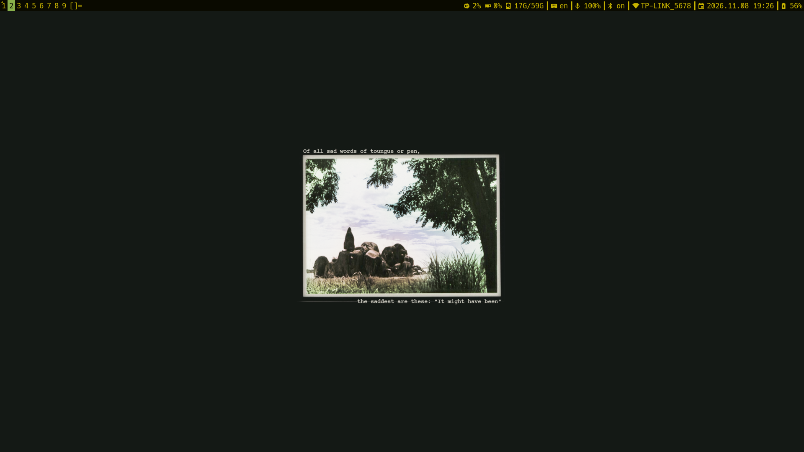
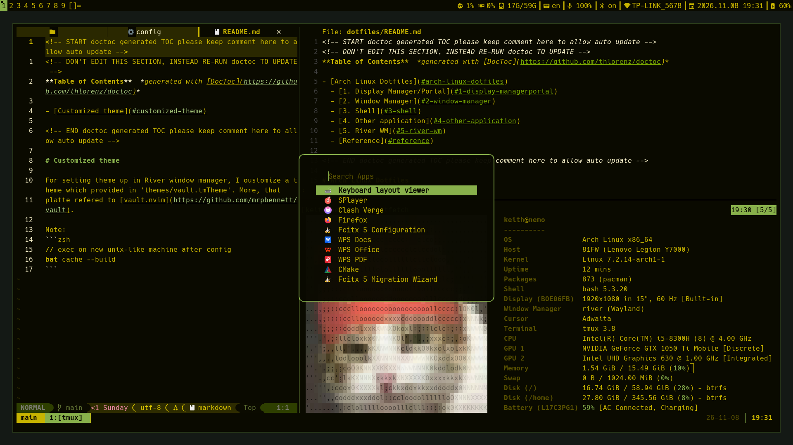

<!-- START doctoc generated TOC please keep comment here to allow auto update -->
<!-- DON'T EDIT THIS SECTION, INSTEAD RE-RUN doctoc TO UPDATE -->
**Table of Contents**  *generated with [DocToc](https://github.com/thlorenz/doctoc)*

- [Arch Linux Dotfiles](#arch-linux-dotfiles)
  - [1. Display Manager/Portal](#1-display-managerportal)
  - [2. Window Manager](#2-window-manager)
  - [3. Shell](#3-shell)
  - [4. Other application](#4-other-application)
  - [5. River WM](#5-river-wm)
  - [Reference](#reference)

<!-- END doctoc generated TOC please keep comment here to allow auto update -->

# Arch Linux Dotfiles

Here is a configuration for Arch linux with River-classic and Niri WM.

At the beginnning, you may need refer ./Arch/arch_install_instruction/README.md to install Arch Linux OS and infrastructure. There is a overview for Arch in the following.

---

## 1. Display Manager/Portal

SDDM with silent greeter.

## 2. Window Manager

River Classic and Niri.

> Here is not River Compositor.

## 3. Shell

Noctalia v5.

## 4. Other application

application, intalled or recommended to install, are introduced in `Arch/arch_install_instruction/README.md` specifically.

## 5. River WM

More, this repo provide a extra config of river-classic WM for the suckless.

    
    
The River desktop with dam after configuration

    
    
Overview of River 

## Reference

+ River
    + https://wiki.archlinux.org/title/River-classic
    + https://codeberg.org/river/river-classic
+ Niri
    + https://github.com/niri-wm/niri
+ Silent SDDM
    + https://github.com/uiriansan/SilentSDDM
+ Noctalia
    + https://noctalia.dev/shell
